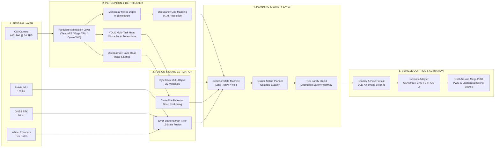
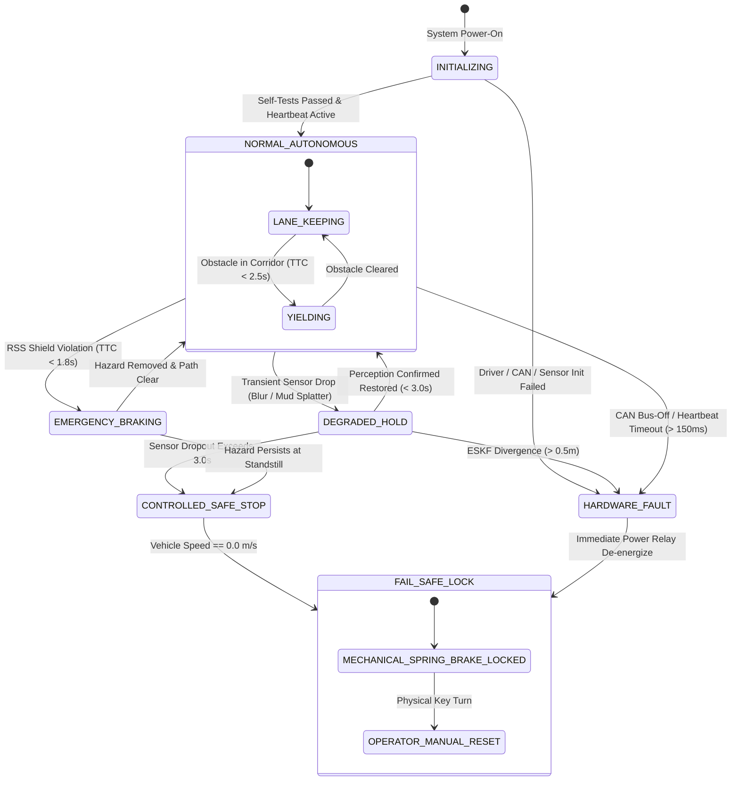
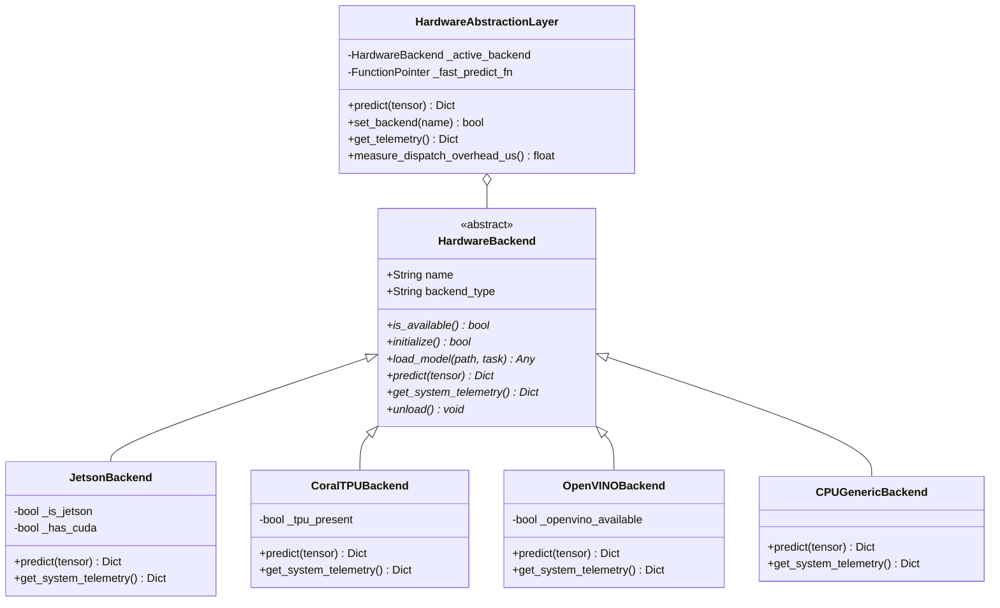

# APEX LKA • System Architecture & Technical Diagrams

This document collects formal architectural blueprints, dataflow diagrams, and state machines documenting the APEX LKA autonomous vehicle platform.

---

## 1. End-to-End System Dataflow



---

## 2. Hardware Interconnect & Wiring Blueprint

```
+----------------------------------------------------------------------------------------------------+
|                                    NVIDIA JETSON ORIN NANO 4GB                                     |
|                                                                                                    |
|   +--------------------------+    +--------------------------+    +----------------------------+   |
|   | MIPI-CSI2 Camera (IMX219)|    | USB 3.2 Type-A           |    | Pin 8/10 (UART0) / USB     |   |
|   | 640x360 @ 30 FPS         |    | Vector/Peak CAN-to-USB   |    | Dual Arduino Mega Serial   |   |
|   +--------------------------+    +--------------------------+    +----------------------------+   |
+-------------------------------------------------|--------------------------------|-----------------+
                                                  |                                |
                                          CAN High / CAN Low               115200 Baud UART
                                                  |                                |
                                                  v                                v
+----------------------------------------------------------------------------------------------------+
|                                    DUAL ARDUINO ACTUATION RIG                                      |
|                                                                                                    |
|   +---------------------------------------------------+      +---------------------------------+   |
|   |            PRIMARY CONTROLLER (MEGA 2560)         |      |    SECONDARY SAFETY SUPERVISOR  |   |
|   |                                                   |      |                                 |   |
|   |  - MCP2515 CAN SPI Module (500 kbps)              |      |  - Steering Potentiometer (ADC) |   |
|   |  - Stepper Direction & Step Pins (PWM)            |----->|  - Discrepancy Delta Checker    |   |
|   |  - Throttle DAC Output (0-5V)                     |      |  - Optoisolated Cutout Relay    |   |
|   |  - 100ms Hardware Watchdog Timer                  |      |  - Manual E-Stop Pushbutton     |   |
|   +---------------------------------------------------+      +---------------------------------+   |
|                             |                                                |                     |
+-----------------------------|------------------------------------------------|---------------------+
                              v                                                v
               +-----------------------------+                  +-----------------------------+
               | High-Torque Steering Servo  |                  | Normally-Closed Brake Valve |
               | Actuator (BAJA Tie-Rods)    |                  | Mechanical Spring Actuator  |
               +-----------------------------+                  +-----------------------------+
```

---

## 3. Failsafe State Machine (ISO 26262 ASIL-B)



---

## 4. Multi-Hardware Abstraction Layer (HAL) Class Hierarchy


