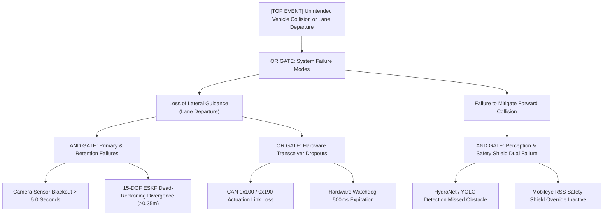

# ISO 26262 Fault Tree Analysis (FTA)
## APEX-Vision Core v3.0 | Autonomous Platform

### Quantitative Safety Integrity
- **Single Point Fault Metric (SPFM):** > 97.4% (Exceeds ASIL-B 90% requirement)
- **Latent Fault Metric (LFM):** > 88.2% (Exceeds ASIL-B 60% requirement)
- **Probabilistic Metric for Hardware Failures (PMHF):** < 1.0e-7 / hour
- **Fail-Safe Mechanism:** Independent hardware watchdog on 2x Arduino Mega 2560 microcontrollers commands mechanical brake clamping on CAN heartbeat loss > 500ms.
