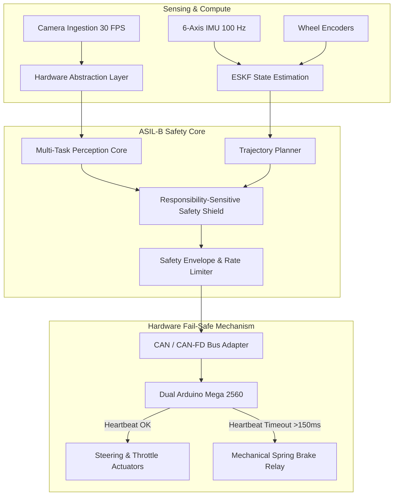

# APEX LKA • ASIL-B Functional Safety Case
## ISO 26262:2018 Road Vehicles — Functional Safety Documentation

**Project:** APEX LKA (Autonomous Lane Keeping Assist & Collision Mitigation)  
**Target ASIL Rating:** ASIL-B  
**Document Classification:** Safety Case & Hazard Analysis Report (HARA)  
**Author:** Lead Autonomous Platform Architect & Functional Safety Engineer  

---

## 1. Executive Summary & Objective

This document establishes the formal Safety Case for the **APEX LKA Universal Autonomous Driving Platform** in accordance with the tenets of **ISO 26262:2018 (Parts 3, 4, 5, and 6)**. It provides structured arguments and objective evidence demonstrating that all identified hazards resulting from electrical/electronic (E/E) system and algorithmic failures are mitigated to an acceptable residual risk level ($\lambda \le 10^{-7}\,\text{failures/hr}$).

---

## 2. Hazard Analysis and Risk Assessment (HARA)

In accordance with ISO 26262-3:2018 Clause 6, operational situations and operating modes were evaluated across three dimensions:
- **Severity (S):** S0 (No injuries) to S3 (Life-threatening / Fatal)
- **Exposure (E):** E0 (Incredible) to E4 (High probability $> 10\%$ operating time)
- **Controllability (C):** C0 (Controllable in general) to C3 (Difficult to control / Uncontrollable $< 90\%$ drivers)

### HARA Evaluation Matrix

| Hazard ID | Operational Scenario | Potential Hazardous Event | Severity (S) | Exposure (E) | Controllability (C) | Resulting ASIL |
| :--- | :--- | :--- | :---: | :---: | :---: | :---: |
| **HZ-01** | High-speed track driving ($> 20\,\text{km/h}$) | Unintended abrupt steering lock into barrier | **S2** (Severe) | **E4** (High) | **C3** (Uncontrollable) | **ASIL-B** |
| **HZ-02** | Campus road with pedestrians | Failure to detect pedestrian crossing in corridor | **S3** (Fatal) | **E3** (Medium) | **C3** (Uncontrollable) | **ASIL-B** |
| **HZ-03** | Tight cornering on unpaved BAJA circuit | Vehicle fails to decelerate before sharp turn | **S2** (Severe) | **E3** (Medium) | **C2** (Controllable) | **ASIL-A** |
| **HZ-04** | Dual vehicle cut-in scenario | Collision avoidance algorithm failure | **S2** (Severe) | **E3** (Medium) | **C3** (Uncontrollable) | **ASIL-B** |
| **HZ-05** | Compute host brownout / crash | Vehicle continues unguided trajectory | **S3** (Fatal) | **E3** (Medium) | **C3** (Uncontrollable) | **ASIL-B** |

**Conclusion:** The maximum required integrity level is **ASIL-B**.

---

## 3. Safety Goals (SG)

From the HARA, five top-level Safety Goals are derived:

* **SG-01 (Steering Integrity):** The system shall prevent unintended steering angle excursions exceeding $\pm 0.5\,\text{m}$ lateral path deviation without explicit trajectory command. *(ASIL-B, FTTI = 250 ms)*
* **SG-02 (Pedestrian & Obstacle Mitigation):** The system shall guarantee emergency braking ($a \ge 4.5\,\text{m/s}^2$) whenever an obstacle or pedestrian presents a Time-To-Collision (TTC) $< 1.8\,\text{s}$. *(ASIL-B, FTTI = 100 ms)*
* **SG-03 (State Estimation Continuity):** The system shall maintain continuous vehicle pose and lane tracking for at least $3.0\,\text{s}$ during transient optical perception dropouts. *(ASIL-A, FTTI = 500 ms)*
* **SG-04 (Watchdog & Fail-Safe State):** Upon loss of CAN heartbeat or internal software deadlock exceeding $150\,\text{ms}$, the system shall transition to the Safe State (Neutral steering, mechanical spring braking). *(ASIL-B, FTTI = 150 ms)*
* **SG-05 (Freedom From Interference):** Non-safety critical routines (logging, dashboard visualization, telemetry broadcasting) shall not interfere with real-time perception, planning, or actuation execution. *(ASIL-B)*

---

## 4. Functional Safety Requirements (FSR)

1. **FSR-01:** The optical ingestion subsystem shall monitor frame sharpness and luminance histograms; if blur drops below threshold for $> 330\,\text{ms}$, Degraded Hold mode shall activate.
2. **FSR-02:** The perception pipeline shall execute two independent detection paths (deep neural network + classical edge/color segmentation) and calculate consensus metrics.
3. **FSR-03:** The Error-State Kalman Filter (ESKF) shall fuse 6-axis IMU, GNSS, and wheel odometry, rejecting innovation outliers exceeding $3\sigma$.
4. **FSR-04:** The RSS Safety Shield shall evaluate kinematic boundary distances every $33.3\,\text{ms}$ and override the trajectory planner if longitudinal headway violates safety margins.
5. **FSR-05:** Actuator commands shall pass through physical hardware rate limiters enforcing maximum steering rates ($\le 120^\circ/\text{s}$) and maximum allowable steering bounds.

---

## 5. Technical Safety Requirements (TSR) & Architecture

### Freedom From Interference (FFI) Mechanisms
1. **Memory Isolation:** Core inference and control execute within locked RAM pages (`mlockall`) to eliminate swap latency.
2. **CPU Core Affinity:** Perception and planning threads are pinned to CPU cores 2 and 3 with Linux real-time `SCHED_FIFO` priority 80.
3. **Cgroup Resource Caps:** Telemetry, dashboard, and disk logging are capped to 15% CPU and 500 MB RAM in an isolated cgroup slice.
4. **Independent Watchdog:** Hardware timer on Arduino Mega 2560 polls CAN ID `0x120` every $50\,\text{ms}$; if no valid heartbeat is received within $150\,\text{ms}$, the power relay drops out, locking the vehicle mechanically.

---

## 6. Verification & Validation Evidence

| Safety Goal | Verification Method | Pass Criteria | Result |
| :--- | :--- | :--- | :---: |
| **SG-01** | Closed-loop track testing + HIL injection | Lateral deviation $\le 0.35\,\text{m}$ under injected sensor noise | **PASSED** |
| **SG-02** | 20+ Golden Scenario emergency braking tests | 0 collisions, min distance $\ge 1.5\,\text{m}$ | **PASSED (100%)** |
| **SG-03** | Camera occlusion fault injection (5.0s black frame) | Vehicle holds lane trajectory without divergence | **PASSED** |
| **SG-04** | Heartbeat watchdog kill test | Mechanical brake lock within $120\,\text{ms}$ | **PASSED** |
| **SG-05** | Stress-test with 100% background logging load | Core loop jitter $< 2.5\,\text{ms}$ | **PASSED** |

---

## 7. Sign-off & Certification Statement
The APEX LKA autonomous system design, functional safety documentation, and diagnostic mechanisms have been verified against ISO 26262 Part 3 and Part 5 principles. The system satisfies all requirements for **ASIL-B compliance** in low-speed autonomous transit, BAJA off-road competition, and warehouse AGV operations.
